<p align="center">
  
</p>

<p align="center">
  
</p>

<p align="center">
  <a href="https://linkedin.com/in/ahmed-akhridi"></a>
  <a href="mailto:ahmed.akhridi@uir.ac.ma"></a>
  
  
</p>

---

```
┌──────────────────────────────────────────────────────────────────────────────┐
│                                                                              │
│   ██████╗██╗   ██╗██████╗ ███████╗██████╗     ██████╗ ██████╗  ██████╗      │
│  ██╔════╝╚██╗ ██╔╝██╔══██╗██╔════╝██╔══██╗   ██╔═══██╗██╔══██╗██╔════╝     │
│  ██║      ╚████╔╝ ██████╔╝█████╗  ██████╔╝   ██║   ██║██████╔╝╚█████╗      │
│  ██║       ╚██╔╝  ██╔══██╗██╔══╝  ██╔══██╗   ██║   ██║██╔═══╝  ╚═══██╗     │
│  ╚██████╗   ██║   ██████╔╝███████╗██║  ██║   ╚██████╔╝██║     ██████╔╝     │
│   ╚═════╝   ╚═╝   ╚═════╝ ╚══════╝╚═╝  ╚═╝    ╚═════╝ ╚═╝     ╚═════╝     │
│                                                                              │
│                    SECURITY OPERATIONS CENTER — v7mdd                        │
└──────────────────────────────────────────────────────────────────────────────┘
```

## `> whoami`

```yaml
Name:         Ahmed Akhridi
Role:         Cybersecurity Engineering Student (5th Year)
University:   Université Internationale de Rabat (UIR)
Graduation:   2027 (PFE — End-of-Studies Internship Seeker)
Domains:      Blue Team Defense, Offensive Security, Cloud Architecture, AI-Powered Threat Detection
Status:       🟢 ACTIVE — Open to PFE & internship opportunities
```

> 🛡️ I build, break, and secure systems. From deploying **Suricata IDS** with machine learning anomaly detection
> to cracking **RSA weak keys** at **428× GPU speedup** — I operate across the full cybersecurity spectrum.
> Currently ranked **Top 11% nationally** in the Morocco Academia Cyber Competition (MACC 2026).

---

## `> cat /proc/skills`

### 🔵 Blue Team — Detection & Response
<p>
  
  
  
  
  
  
</p>

### 🔴 Offensive Security & Cryptography
<p>
  
  
  
  
  
</p>

### 🏗️ Infrastructure & Network Security
<p>
  
  
  
  
  
  
</p>

### ☁️ Cloud & AI/ML
<p>
  
  
  
  
  
</p>

### 💻 Programming & Development
<p>
  
  
  
  
  
  
  
</p>

---

## `> ls -la /opt/projects/`

> ⚠️ **CLASSIFIED DOSSIERS** — Authorized Personnel Only

<table>
<tr>
<td width="50%" valign="top">

### 🔒 `DOSSIER-001` — Suricata IDS + Machine Learning
> **Classification:** `TOP SECRET`

Deployed Suricata NIDS on Linux for real-time network traffic inspection. Built a Python data pipeline to extract features from EVE JSON logs and trained ML/DL models for **advanced anomaly detection**, catching zero-day and unknown threats.

`Suricata` `Python` `ML/DL` `EVE JSON` `Linux`

</td>
<td width="50%" valign="top">

### 🔒 `DOSSIER-002` — Hybrid IDS: Snort & Zeek
> **Classification:** `CONFIDENTIAL`

Architected a joint deployment of **Snort** (signature-based) and **Zeek** (behavioral analysis) for complete network visibility. Correlated alerts and logs across both probes to reduce false positives with custom detection rules.

`Snort` `Zeek` `Log Correlation` `NIDS`

</td>
</tr>

<tr>
<td width="50%" valign="top">

### 🔒 `DOSSIER-003` — Brute Force Attack Lifecycle
> **Classification:** `RESTRICTED`

Full purple-team exercise: built a **Flask** target app, profiled users for recon-based wordlists, executed multi-vector attacks (CLI, GUI, custom Python scripts), then implemented **Defense-in-Depth** (2FA, CAPTCHA, lockouts) and tested **Low & Slow** evasion techniques.

`Flask` `Python` `2FA` `CAPTCHA` `Purple Team`

</td>
<td width="50%" valign="top">

### 🔒 `DOSSIER-004` — RSA Weak-Key Detection (GPU)
> **Classification:** `TOP SECRET`

Parallelized Fermat factorization attack to audit RSA keys with closely-spaced prime factors. Benchmarked **MPI**, **UPC**, and **CUDA** implementations in C, achieving up to **428× speedup** with GPU acceleration.

`C` `CUDA` `MPI` `UPC` `RSA` `HPC`

</td>
</tr>

<tr>
<td width="50%" valign="top">

### 🔒 `DOSSIER-005` — Enterprise OS Security (AD & Linux)
> **Classification:** `CONFIDENTIAL`

Designed an isolated hybrid enterprise environment with **Windows Server AD** + **Ubuntu Linux**. Hardened via GPO, PAM policies, SSH least-privilege access. Audited defenses with **Kali Linux** penetration tests.

`Active Directory` `Linux` `Kali` `PAM` `SSH`

</td>
<td width="50%" valign="top">

### 🔒 `DOSSIER-006` — Cloud-Native Audio App (Azure)
> **Classification:** `RESTRICTED`

Deployed a full-stack React/Node.js application on **Azure App Service** with Blob Storage and SQL Database. Integrated Azure AI services (Speech, Translator, Language) with secure API management.

`Azure` `React` `Node.js` `Azure AI` `PaaS`

</td>
</tr>

<tr>
<td width="50%" valign="top">

### 🔒 `DOSSIER-007` — MoodleMate: AI RAG Companion
> **Classification:** `CONFIDENTIAL`

Built a local RAG backend with **FastAPI**, **Llama 3.1** (via Groq), **LangChain** and **ChromaDB**. Eliminated AI hallucinations through strict document grounding with exact page citations and deep links.

`FastAPI` `Llama 3.1` `LangChain` `ChromaDB` `RAG`

</td>
<td width="50%" valign="top">

### 🔒 `DOSSIER-008` — Secure Vehicle Rental DB
> **Classification:** `RESTRICTED`

Engineered a vehicle rental database with **RBAC**, least-privilege access, secure authentication, and **SQL injection prevention**. Applied vulnerability assessment, security auditing, and backup/disaster recovery.

`RBAC` `SQLi Prevention` `DB Hardening` `Audit`

</td>
</tr>

<tr>
<td colspan="2" align="center">

### 🔒 `DOSSIER-009` — MDM + VPN Architecture (FortiGate)
> **Classification:** `TOP SECRET` — Deployed at **SONACOS**

Implemented **ManageEngine MDM** for enterprise mobile fleet management and deployed a **FortiGate SSL-VPN** architecture with granular traffic filtering, bandwidth optimization, and encrypted remote access for field employees.

`FortiGate` `VPN SSL` `ManageEngine MDM` `Fortinet`

</td>
</tr>
</table>

---

## `> cat /var/log/career.log`

```
[2026] ████████████████████████████████████░░░░ SONACOS — Network & Systems Security Intern
       ├── MDM Deployment (ManageEngine) — Centralized mobile fleet security
       ├── FortiGate SSL-VPN Architecture — Encrypted remote access with granular filtering
       └── Endpoint hardening & internal data protection

[2023] ██████████░░░░░░░░░░░░░░░░░░░░░░░░░░░░░ Atner Atlas Energie — Web Development Intern
       ├── Led corporate website redesign (WordPress)
       └── Performance optimization & security hardening
```

---

## `> gpg --list-keys certifications`

<p align="center">


</p>

---

## `> nmap --stats`

<p align="center">
  
  
</p>

<p align="center">
  
</p>

---

## `> cat /proc/contributions`

<picture>
  <source media="(prefers-color-scheme: dark)" srcset="https://raw.githubusercontent.com/v7mdd/v7mdd/output/github-snake-dark.svg" />
  <source media="(prefers-color-scheme: light)" srcset="https://raw.githubusercontent.com/v7mdd/v7mdd/output/github-snake.svg" />
  
</picture>

---

## `> netstat -establish`

<p align="center">
  <a href="https://linkedin.com/in/ahmed-akhridi"></a>
  <a href="mailto:ahmed.akhridi@uir.ac.ma"></a>
  <a href="https://github.com/v7mdd"></a>
</p>

---

<p align="center">
  
</p>

<p align="center">
  <sub>🔐 <code>SESSION LOGGED // SHA-256: e3b0c44298fc1c149afbf4c8996fb924 // © 2026 Ahmed Akhridi</code></sub>
  <br/>
  <sub><code>root@ahmed:~$ echo "If you made it this far, let's connect." && exit</code></sub>
</p>
